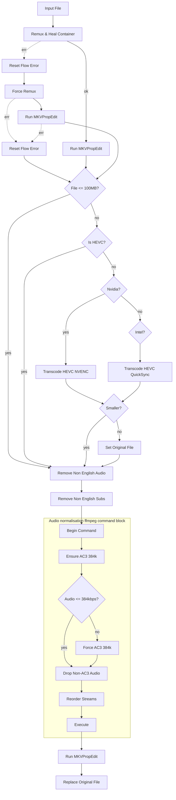

# tdarr

Version-controlled Tdarr configuration.

Server: `tdarr-server:8266` (Tdarr 2.86.01), nodes `Nvidia` and `Intel`.

## Layout

```
flows/      Flow definitions, exported from the Tdarr UI as JSON.
plugins/    Local plugin source (.js), mirrors the server plugin folder.
```

## flows/

Flows are not files on the server — they live in SQLite at
`server/Tdarr/DB2/SQL/database.db`, table `flowsjsondb`, one JSON blob per row.
(The `DB2/FlowsJSONDB/` folder is an empty leftover from an older storage
format.) These files are therefore exported artifacts, not a source of truth.
The round trip is manual:

- **Export**: Flows tab → open the flow → export to JSON → save over the file here.
- **Import**: Flows tab → import → select the file.

Commit after every meaningful change so the repo stays a usable backup. If a
flow is edited in the UI and not re-exported, this repo is stale — re-export
before making changes on disk.

Note the DB row uses a slightly different key set than a UI export: `_id`,
`name`, `priority`, `flowPlugins`, `flowEdges`, `isUiLocked`, with no
`description` or `tags`. Edges carry `animated` and `type` fields that the UI
export strips. `flows/transcode-pipeline.json` is in DB shape and imports fine.

## plugins/

These are real source files. On the server they live under:

- Classic plugins: `/app/server/Tdarr/Plugins/Local/*.js`
- Flow plugins: `/app/server/Tdarr/Plugins/FlowPlugins/LocalFlowPlugins/<name>/<version>/index.js`

Copy them in preserving that structure. `LocalFlowPlugins` is currently empty —
everything in use is either a community flow plugin or a local classic plugin.

---

# Transcode Pipeline

The single flow (`a_CeSjPzb`) applied to the TV library. Its job: get every file
to MKV + HEVC video + exactly one English AC3 audio track + English subtitles,
in that stream order, with accurate track statistics.

## Stages

**1. Container.** `Remux & Heal Container` runs the local `RemuxMKV` plugin,
which no-ops when the file is already MKV. On failure the flow falls through
`Reset Flow Error` → `Force Remux` (`ForceRemuxMKV`), which rebuilds the
container unconditionally — the healing path for files with broken indexes.
Either way it lands on `Run MKVPropEdit`, which writes track statistics tags.

**2. Size gate.** `File <= 100MB?` sends tiny files straight to the audio and
subtitle cleanup, skipping video transcode entirely — not worth the GPU time.

**3. Video.** `Is HEVC?` skips anything already HEVC. Otherwise the flow picks
an encoder by node name: `Nvidia?` routes to NVENC, else `Intel?` routes to
QuickSync (`Boosh_FFMPEG_QSV_HEVC`). `Compare File Size Ratio` then guards the
result — if the new file isn't smaller, `Set Original File` discards it and the
original is kept.

**4. Language cleanup.** `Remove Non English Audio` and `Remove Non English Subs`
(local `CleanAudio` / `CleanSubs`) strip non-English tracks and commentary. SDH
subtitles are kept.

**5. Audio normalisation.** An ffmpeg-command block that plans one command and
executes it once. `Begin Command` snapshots the streams, then:

- `Ensure AC3 384k` creates an English AC3 track if one doesn't already exist,
  cloned from the highest-channel-count English stream. It requests 6 channels
  and the plugin clamps to `min(wanted, available)`, so 8ch → 5.1, 6ch → 5.1,
  2ch → stereo. One bitrate is used for every channel layout: 384k is the rate
  DVD-Video used for AC3 5.1, and is generous for stereo.
- `Ensure Audio Stream` matches on codec **and channel count only** — it will
  not touch a valid AC3 track at the wrong bitrate. So `Audio <= 384kbps?`
  catches files whose AC3 track is at some other rate and routes them through
  `Force AC3 384k`, which appends `-c:a ac3 -b:a 384k` as overall output
  arguments. ffmpeg's last-matching specifier wins, overriding the per-stream
  `-c:N copy`, and the audio is re-encoded. That node sits on the out-of-range
  branch only: Custom Arguments unconditionally sets `shouldProcess`, so wiring
  it inline would remux every file on every scan forever.
- `Drop Non-AC3 Audio` removes every audio stream whose `codec_name` is not
  `ac3`, leaving only the track Ensure created or kept.
- `Reorder Streams` sorts to video → audio → subtitles, highest channel count
  first within audio.
- `Execute` builds and runs the command. Streams with no output args get
  `-c copy`, so video and subtitles are remuxed, never re-encoded. If nothing
  changed, it skips ffmpeg entirely.

**6. Finalise.** A second `Run MKVPropEdit` re-stamps statistics tags so the new
audio track reports its real bitrate and size, then `Replace Original File`
swaps the cache file over the original. Its `err1` output also goes to Replace —
a tagging failure shouldn't discard a good transcode.

## Graph



## Known wrinkles

- **`Transcode HEVC (Nvidia)` has no `pluginSourceId`**, so it falls back to
  `Community:Tdarr_Plugin_MC93_Migz1FFMPEG`. The QuickSync node pins its plugin
  explicitly. The two paths therefore use different plugins with different
  bitrate logic.
- **`Intel?` routes both outputs to QuickSync**, so a node named anything other
  than `Nvidia` gets the QSV path regardless.
- **Already-processed files are never downgraded in channel count.** Ensure only
  adds a track when none matches; it won't rebuild a stereo track from a
  surround source after the fact.
- **Bitrate normalisation is lossy→lossy.** Any file whose AC3 track isn't at
  384k gets re-encoded. The first AC3 encode from a lossless source is
  effectively transparent, so the second generation starts from near-original
  material — but it is still a generation, and AC3 degrades least gracefully on
  dense, transient-heavy audio (applause, cymbals, orchestral score).
