# tdarr-flow-mkv-hevc-eac3

- **MKV** container
- **HEVC** video
- **English audio only**, directly playable codec
- At most one surround track and one stereo/mono track, surround first
- **At most one English subtitle track**, no commentary or audio description
- Accurate track statistics tags
- Files that already match are left alone

## Stages

### 1. Gate

`Readable Video?` (`fileMedium`) admits video files only. Audio-only files and
files with no readable media (e.g. a truncated download missing its `moov`
atom) exit immediately with the library file untouched.

### 2. Container

`Remux & Heal Container` runs the local `RemuxMKV` plugin, which no-ops on a
file that is already MKV and otherwise stream-copies into Matroska with
`-fflags +genpts`. "Already MKV" is judged by the extension, so two kinds of MKV
are still rewritten: one carrying `mov_text`, which is a misnamed MP4 and gets
the full remux, and one carrying a subtitle ffmpeg cannot decode, which only has
that stream removed.

On failure the flow takes `Reset Flow Error` → `Force Remux` (`ForceRemuxMKV`),
which accepts any input container and adds `+igndts`, enlarged
`analyzeduration`/`probesize`, `-err_detect ignore_err` and
`-avoid_negative_ts make_zero`. If `Force Remux` also fails, the file continues
in its original container.

Both attempts stream-copy font attachments along with the first real video
stream, the audio and the subtitles, and remove the following:

- Embedded thumbnails and other attached pictures.
- Subtitles ffmpeg cannot decode, which would otherwise fail every later command
  at the header.
- Audio description tracks, unless that would leave no audio. MP4 track names do
  not survive the remux, so `CleanTracks` could not recognise them afterwards.

`mov_text` (tx3g) is the one stream that changes format, because it is MP4-only:
where another text subtitle already carries the dialogue the `mov_text` track is dropped, and where none does it is
converted to SRT. Text to text, so nothing is lost. Dropping *every* subtitle on
sight of one `mov_text` track — which is what this used to do — threw away
perfectly good SRT tracks standing beside it.

Each remux branch is followed by `Run MKVPropEdit`, behind an `Is MKV?`
(`checkFileExtension`) guard.

### 3. Video

`Is HEVC?` passes HEVC files straight through. Otherwise the encoder is chosen
by node name:

| condition | plugin                              |
| --------- | ----------------------------------- |
| `Nvidia?` | `Migz1FFMPEG` (NVENC)               |
| `Intel?`  | `Boosh_FFMPEG_QSV_HEVC` (QuickSync) |
| otherwise | `Migz1FFMPEG_CPU`                   |

NVENC and QuickSync fall back to the CPU encoder on error; a CPU failure routes
to `Set Original File`, keeping the source.

Every error edge passes through `Reset Flow Error` first. `flowFailed` survives
an `err1` hop, and a job that ends with it set is reported as a transcode error
however well the rest of the flow went — so without the reset a GPU hiccup
committed a perfectly good file and still reported failure.

`Compare File Size Ratio` guards the output on **both** sides: anything outside
20–100% of the original goes to `Set Original File`, which discards it.

The floor matters as much as the ceiling. It was `0`, which no output can fall
below, and the "smaller than lower bound" handle was wired to accept anyway — so
an encoder that exited 0 having written a truncated file overwrote the source. A
0.1% output was confirmed to replace the library file. Both halves were needed:
raising the floor alone would still have routed the runt to acceptance.

### 4. Language cleanup

`Remove Non English Tracks` (local `CleanTracks`) removes non-English audio and
subtitles, commentary and audio description tracks, and optionally SDH
subtitles — all in a single pass over the file. Font attachments are carried across, so an ASS subtitle
still renders as authored; they are mapped only into MKV, which is the only
container in play that can hold them.

- Commentary is detected from the `comment` disposition flag or `comment` in the
  stream title.
- Audio description is detected from the `visual_impaired` or `descriptions`
  disposition flags, or from `description`, `descriptive` or `visually impaired`
  in the stream title, MediaInfo's `Title` or ExifTool's `Track<N>Name`. It is
  gated by `remove_commentary`.
- SDH is detected from the `hearing_impaired` disposition flag or `sdh` in the
  title. The two tests are independent, gated by `remove_commentary` and
  `remove_sdh` respectively.
- Streams with no language tag are kept.
- The file is never left with no audio. If every audio stream would go — a
  release with no English track at all — **all** of them are kept, not one.
  Choosing between the survivors is not this pass's job: the audio block
  downstream reduces to one surround and one stereo/mono track regardless.
- **At most one subtitle track survives.** Where several English tracks remain,
  it keeps the best one and drops the rest in the same pass. Worst first:

  | rank | kind   | why                                                                                         |
  | ---- | ------ | ------------------------------------------------------------------------------------------- |
  | 4    | forced | covers foreign dialogue only, so as the sole track it leaves most of the dialogue uncovered   |
  | 2    | image  | PGS/VOBSUB cannot be handed to a client as text, so Plex must burn it in — a full transcode  |
  | 1    | SDH    | complete and text, merely noisy                                                              |
  | 0    | plain  | preferred                                                                                    |

  Two English text tracks are indistinguishable to a player whenever the source
  flags neither. Show B S03E08 labelled its SDH track in the title only, so both
  came out as plain `eng`/`subrip` with nothing but `default` between them,
  Plex's subtitle selector matched both, and its SRT output cannot represent
  that:

  ```
  [srt] SRT supports only a single subtitles stream
  [TranscodeOutputStream] Session appears to have died from under us
  ```

  Writing the missing `hearing_impaired` flag would have fixed that one
  selector. Keeping one track makes the failure unreachable for any selector.
  SDH still survives when it is the *only* English subtitle — the goal is one
  track, not "no SDH".

### 5. Audio

An ffmpeg-command block that plans one command and executes it once. Result:

| source audio                             | result                                                           |
| ---------------------------------------- | ---------------------------------------------------------------- |
| surround (4–8ch), with or without stereo | E-AC3 surround + E-AC3 2.0 @192k                                 |
| 7.1                                      | downmixed to 5.1, plus E-AC3 2.0 @192k                           |
| stereo only                              | single E-AC3 2.0 @192k                                           |
| mono only                                | single E-AC3 1.0 @96k                                            |
| no English track                         | not converted, reduced to one surround and one stereo/mono track |

The layout is decided by channel count alone, not by existing codec. Bitrates
apply only to tracks that are encoded, and are ceilings, not targets: a track is
never encoded above what its source carried. A surround track that is already
E-AC3 is stream-copied at its own bitrate, even above 384k. Exactly one track comes out flagged `default`, and it is the first.

Nodes, in order:

- `Begin Command` snapshots the streams.
- `Force MKV Container` pins the output container (`Begin Command` otherwise
  seeds it from whatever the working file currently is).
- `Surround Present?` — `checkStreamProperty` on `channels`, matching
  `4,5,6,7,8`.
- `Ensure E-AC3 Surround 384k` requests 6 channels; the plugin clamps to
  `min(wanted, available)`, so 8ch → 5.1, 6ch → 5.1, 4ch → 4ch.
- `Ensure E-AC3 Stereo 192k` always runs on the surround branch and on the
  `Stereo Present?` branch. It matches on codec **and** exact channel count, so
  it is a no-op on a stereo-only source that is already E-AC3.
- `Ensure E-AC3 Mono 96k` handles mono-only files. Mono is never upmixed.
- `Reorder Streams` is configured for `streamTypes` only. It groups the streams
  video / audio / subtitle; its sort is stable, so the audio order the next node
  sets is the one that survives.
- `Normalise Audio Tracks` (local plugin) reduces to one surround and one
  stereo/mono track, preferring the configured language, then E-AC3, then
  channel count, then bitrate, and sets the audio order with surround first. It
  is deliberately the **last** node before `Execute`. It also owns three things
  `Ensure` gets wrong, because `Ensure` builds a track by deep-cloning the stream it
  converts from:
  - **The default flag.** Every generated track inherits the source's, so two
    `Ensure` nodes produce two tracks both flagged `default` — a malformed MKV,
    and one Plex refused to transcode. Normalise emits `-disposition`, without
    which ffmpeg copies the flag from the input regardless of what the planned
    stream says.
  - **The bitrate.** `Ensure` asks for a flat 384k/192k however little the
    source carried. A 197kbps HE-AAC web-rip re-encoded to both grew a 633MB
    file to 801MB. Normalise caps each track at the source's own bitrate —
    read from `bit_rate`, else the `BPS` tag, since Matroska rarely fills the
    former — rounded down to a 32k step and never below `Bitrate Floor`
    (128k). An unknown source bitrate is never guessed at.
  - **The timestamp origin.** E-AC3 carries 256 samples of encoder delay, which
    Matroska records as `CodecDelay` and readers report as a first packet at
    `-0.005s` unless the muxer shifted the file to compensate. ffmpeg's default
    `-avoid_negative_ts auto` shifts only when it decides it must, so the
    outcome tracks interleaving rather than input: S03E07 came out with every
    stream at `>= 0`, S03E08 with its stereo track negative. Normalise pins
    `-avoid_negative_ts make_zero` — but only when the command is rewriting the
    file anyway, because `Execute` forces `shouldProcess` whenever
    `overallOuputArguments` is non-empty, and an unconditional argument would
    rewrite the whole library on every pass. That test only means anything with
    nothing downstream of it: `Reorder Streams` sets `shouldProcess` itself when
    it moves a stream, and while it ran *after* Normalise a reorder-only rewrite
    went out unpinned.
- `Execute` builds and runs the command. Streams with no output args get
  `-c copy`, so video and subtitles are remuxed, never re-encoded.

`Ensure Audio Stream` matches the configured language and falls back to `und`
for untagged streams, never to "any language" — so a file with no English audio
has nothing generated and keeps its original tracks unconverted, reduced by
`Normalise Audio Tracks` like any other file.

The block is idempotent: on a file that already matches the policy both Ensure
nodes report "File already has…" and nothing is re-encoded. Files produced
before the default-flag fix are the exception — they are rewritten once, as a
stream copy, to correct their flags, and are stable from then on.

`Execute` has no error edge; an ffmpeg failure fails the job.

### 6. Finalise

`File Changed?` (`checkFileChanged`) compares the working file against the
original library file by path **and** size.

- Changed → `Is MKV?` → `Run MKVPropEdit` re-stamps statistics tags → `Replace
  Original File`. A file that is not MKV skips `Run MKVPropEdit`.
- Unchanged → straight to `Replace Original File`, which is itself a no-op.

The final `Run MKVPropEdit` has no `err1` edge, so a failed run never commits to
the library: the working copy stays in cache and the job reports the error.

## Graph

```mermaid
flowchart TD
    IN[Input File] --> MED{Readable Video?}
    MED -->|other / audio-only| STOP([end, file untouched])
    MED -->|video| REMUX[Remux & Heal Container]
    REMUX -->|processed| MKV1{Is MKV?}
    MKV1 -->|yes| PROP1[Run MKVPropEdit]
    MKV1 -->|no| HEVC
    REMUX -->|no change| HEVC
    REMUX -.->|err| RST1[Reset Flow Error]
    RST1 --> FORCE[Force Remux]
    FORCE --> MKV2{Is MKV?}
    MKV2 -->|yes| PROP2[Run MKVPropEdit]
    MKV2 -->|no| HEVC
    FORCE -.->|err| RST2[Reset Flow Error]
    PROP2 -.->|err| RST2
    RST2 --> HEVC
    PROP1 --> HEVC
    PROP2 --> HEVC

    HEVC{Is HEVC?}
    HEVC -->|yes| CLEAN
    HEVC -->|no| NV{Nvidia?}
    NV -->|yes| ENC1[Transcode NVENC]
    NV -->|no| INTEL{Intel?}
    INTEL -->|yes| ENC2[Transcode QuickSync]
    INTEL -->|no| ENC3[Transcode CPU]
    ENC1 -.->|err| RSTG[Reset Flow Error]
    ENC2 -.->|err| RSTG
    RSTG --> ENC3
    ENC3 -.->|err| RST3[Reset Flow Error]
    RST3 --> ORIG
    ENC1 --> RATIO{Compare File Size Ratio}
    ENC2 --> RATIO
    ENC3 --> RATIO
    RATIO -->|20–100%| CLEAN
    RATIO -->|outside| ORIG[Set Original File]
    ORIG --> CLEAN

    CLEAN[Remove Non English Tracks] --> START[Begin Command]
    CLEAN -.->|err| RST4[Reset Flow Error] --> START

    START --> CONT[Force MKV Container]
    CONT --> SURR{Surround Present?}
    SURR -->|yes| ENSS[Ensure E-AC3 Surround 384k]
    ENSS --> ENST[Ensure E-AC3 Stereo 192k]
    SURR -->|no| ST{Stereo Present?}
    ST -->|yes| ENST
    ST -->|no| ENSM[Ensure E-AC3 Mono 96k]
    ENST --> ORDER[Reorder Streams]
    ENSM --> ORDER
    ORDER --> NORM[Normalise Audio Tracks]
    NORM --> EXEC[Execute]

    EXEC --> CHG{File Changed?}
    CHG -->|no| REPL[Replace Original File]
    CHG -->|yes| MKV3{Is MKV?}
    MKV3 -->|yes| PROP3[Run MKVPropEdit]
    MKV3 -->|no| REPL
    PROP3 --> REPL

    subgraph audio [Audio ffmpeg command block]
        START
        CONT
        SURR
        ST
        ENSS
        ENST
        ENSM
        ORDER
        NORM
        EXEC
    end
```



## Local plugins

Classic plugins live at `/app/server/Tdarr/Plugins/Local/*.js`; flow plugins at
`/app/server/Tdarr/Plugins/FlowPlugins/LocalFlowPlugins/<category>/<name>/<version>/index.js`.
`plugins/` mirrors that structure.

Used by the flow:

- `RemuxMKV` — stream-copy remux to MKV, no-op if already MKV (unless it holds
  `mov_text`).
- `ForceRemuxMKV` — permissive remux, any input container.
- `Boosh_FFMPEG_QSV_HEVC` — QuickSync HEVC encode. Finds the video's MediaInfo
  track by `StreamOrder`, because MediaInfo's order differs from ffprobe's.
- `CleanTracks` — single-pass removal of non-English / commentary / audio
  description / SDH tracks.
- `normaliseAudioTracks` — reduce to one surround + one stereo/mono track and
  set audio order.

Not referenced by the flow, kept in the repo: `CleanAudio`, `CleanSubs`,
`keepOneAudioStream`, `00td_action_remux_container`, `MC93_Migz3CleanAudio`,
`sdf5_Thierrrrry_Remove_Non_English_Audio`.

## Deploying a change

Flow edits take effect on import. Local plugin changes do not — nodes run
plugins from their own synced copy at `/app/Tdarr_Node/assets/app/plugins/...`.

1. Copy the plugin file to the server, preserving the directory layout.
2. Restart the Tdarr **node** (not just the server).
3. If the flow changed: Flows tab → import → `flows/transcode-pipeline.json`.

Flows are stored in SQLite at `server/Tdarr/DB2/SQL/database.db`, table
`flowsjsondb`, one JSON blob per row; `flows/*.json` are exported artifacts.
Export via Flows tab → open flow → export to JSON.

Verify before a bulk run:

```sh
pnpm test        # assertions against the real flow and real plugin source
pnpm lint:flow   # structural lint
pnpm fuzz        # synthetic files through the flow
```

Server: `tdarr-server:8266` (Tdarr 2.86.01), nodes `Nvidia` and `Intel`.
