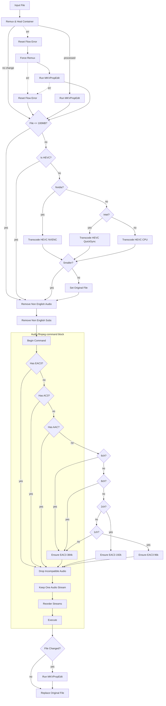

# tdarr

Version-controlled Tdarr configuration.

Server: `tdarr-server:8266` (Tdarr 2.86.01), nodes `Nvidia` and `Intel`.

## Layout

```
flows/      Flow definitions, exported from the Tdarr UI as JSON.
plugins/    Local plugin source (.js), mirrors the server plugin folder.
```

## flows/

Flows are not files on the server — they live in SQLite at
`server/Tdarr/DB2/SQL/database.db`, table `flowsjsondb`, one JSON blob per row.
(The `DB2/FlowsJSONDB/` folder is an empty leftover from an older storage
format.) These files are therefore exported artifacts, not a source of truth.
The round trip is manual:

- **Export**: Flows tab → open the flow → export to JSON → save over the file here.
- **Import**: Flows tab → import → select the file.

Commit after every meaningful change so the repo stays a usable backup. If a
flow is edited in the UI and not re-exported, this repo is stale — re-export
before making changes on disk.

Note the DB row uses a slightly different key set than a UI export: `_id`,
`name`, `priority`, `flowPlugins`, `flowEdges`, `isUiLocked`, with no
`description` or `tags`. Edges carry `animated` and `type` fields that the UI
export strips. `flows/transcode-pipeline.json` is in DB shape and imports fine.

## plugins/

These are real source files. On the server they live under:

- Classic plugins: `/app/server/Tdarr/Plugins/Local/*.js`
- Flow plugins: `/app/server/Tdarr/Plugins/FlowPlugins/LocalFlowPlugins/<category>/<name>/<version>/index.js`

Copy them in preserving that structure — local flow plugins use the same
`<category>/<name>/<version>/` layout as `CommunityFlowPlugins`, so the relative
`require`s are identical: `../../../../FlowHelpers/...` and
`../../../../../methods/lib`.

Two different consumers resolve these paths, and they fail differently:

- The **server** scans for plugins to populate the editor sidebar. Wrong depth
  shows up in the server log as
  `Cannot find module .../<name>/<version>/index.js/index.js` — it walked three
  levels, ran out, and appended `index.js` to a file.
- The **node** loads the plugin to run it, from
  `/app/Tdarr_Node/assets/app/plugins/...`, not from the server directory. Nodes
  sync their copy from the server, so a newly added local plugin needs a node
  restart before it can run.

A node-side error like
`Plugin does not exist: .../LocalFlowPlugins///<name>/<version>/index.js`
means the **flow node JSON is missing fields**, not that the directory is wrong
— the empty segments are unpopulated category values. Add the node from the
editor sidebar rather than hand-writing it into the flow JSON.

Flow plugins are loaded as compiled JavaScript, so the files here are plain JS
written in the same CommonJS shape the community plugins compile to. Local flow
plugin nodes reference `"sourceRepo": "Local"` in the flow.

Keep every `require` **inside** the plugin function, never at module top level.
The UI reads the file to render a node's inputs, and that happens in a context
where the relative paths to `FlowHelpers` and `methods/lib` do not resolve — a
top-level require makes the whole module unloadable and the editor shows
"Unable to read this plugin during loading". Several community plugins
(`checkAudioCodec`, `checkChannelCount`) follow the same deferred pattern.
Runtime is unaffected either way, so this fails only in the editor.

Currently one local flow plugin:

- `keepOneAudioStream` — keeps a single audio stream, removing the rest.
  Prefers the configured language tag, then the highest channel count, then the
  highest bitrate, then file order. No stock plugin does this.

---

# Transcode Pipeline

The single flow (`a_CeSjPzb`) applied to the TV library. Its job: get every file
to MKV + HEVC video + exactly one English audio track in a directly playable
codec + English subtitles, in that stream order, with accurate track statistics.
Audio is left alone wherever it already direct-plays.

## Stages

**1. Container.** `Remux & Heal Container` runs the local `RemuxMKV` plugin,
which no-ops when the file is already MKV. On failure the flow falls through
`Reset Flow Error` → `Force Remux` (`ForceRemuxMKV`), then `Run MKVPropEdit`.

`RemuxMKV` passes `-fflags +genpts`. DivX-packed AVI carries packets with no
timestamps; without generated timestamps the matroska muxer rejects them
(`Can't write packet with unknown timestamp`) and writes a truncated stub — on
one test file, 7 KB and 0.5 s instead of 91 MB and 13 minutes. ffmpeg still
exits non-zero, so the flow takes the error branch, but the failure is silent
in the sense that nothing downstream knows the container never converted.

**`Force Remux` only handles MKV → MKV.** It is a container *repair* tool for
files that fail stats tagging, not a general fallback, and it declines anything
that is not already Matroska. So the error branch does not heal a failed
container *conversion* — see Known wrinkles.

**2. Size gate.** `File <= 100MB?` sends tiny files straight to the audio and
subtitle cleanup, skipping video transcode entirely — not worth the GPU time.

**3. Video.** `Is HEVC?` skips anything already HEVC. Otherwise the flow picks
an encoder by node name: `Nvidia?` routes to NVENC (`Migz1FFMPEG`), `Intel?` to
QuickSync (`Boosh_FFMPEG_QSV_HEVC`), and anything else falls back to a CPU
encode (`Migz1FFMPEG_CPU`) rather than being handed the wrong GPU path.
`Compare File Size Ratio` then guards the result — if the new file isn't
smaller, `Set Original File` discards it and the original is kept.

**4. Language cleanup.** `Remove Non English Audio` and `Remove Non English Subs`
(local `CleanAudio` / `CleanSubs`) strip non-English tracks and commentary. SDH
subtitles are kept, because `remove_sdh` is `false`.

`CleanSubs` classifies a track as SDH from either the `hearing_impaired`
disposition flag or an `sdh` in its title, and as commentary from either the
`comment` disposition flag or a `comment` in its title. The two are kept
separate on purpose: an earlier version folded the `sdh` title test into the
commentary test, so `remove_commentary: true` silently deleted SDH tracks and
`remove_sdh` was never consulted. Most releases label SDH in the title without
setting the disposition flag, so that path was the one that actually fired.

**5. Audio.** An ffmpeg-command block that plans one command and executes it
once. The policy is **pass-through**: leave audio alone if it already
direct-plays, and only convert what doesn't. `Begin Command` snapshots the
streams and `Force MKV Container` pins the output container, then:

`Force MKV Container` is not cosmetic. `Begin Command` seeds the container from
whatever the working file currently is, so if the stage-1 remux failed the
block would happily write E-AC3 into an AVI — a combination AVI does not
properly support. Pinning it to mkv means the audio command doubles as a
container conversion when the earlier remux could not do it.

- Three `checkAudioCodec` nodes ask in turn whether the file already has
  `eac3`, `ac3` or `aac`. Any hit skips straight to the drop step — no
  re-encode. This is the whole point of the design: a library sweep found ~90%
  of shows already carry one of those three, so normalising everything to a
  single codec meant re-encoding almost the entire library for no playback
  benefit.
- Only if none of the three is present does an `Ensure EAC3` node run, cloning
  the highest-channel-count English stream into E-AC3. Every tier requests 6
  channels and the plugin clamps to `min(wanted, available)`, so 8ch → 5.1,
  6ch → 5.1, 2ch → stereo, 1ch → mono. In practice this fires on DTS, TrueHD,
  FLAC, Opus, Vorbis and MP3 sources.
- **The target bitrate is tiered by channel count**, via a ladder of
  `checkChannelCount` gates ahead of the Ensure nodes:

  | channels | bitrate |
  |---|---|
  | 6, 8 | 384k |
  | 2 | 192k |
  | 1 | 96k |
  | anything else | 384k |

  A flat 384k is right for 5.1 but roughly 4× the source rate for a mono mp3,
  and re-encoding cannot recover what the source already discarded — the file
  just gets bigger. One `.avi` grew 88 → 115 MB (+30%) on a flat 384k, entirely
  in the audio stream.

  The gates test **exact** counts, so they are ordered largest-first: a file
  carrying both a 5.1 track and a stereo commentary must take the 5.1 tier, and
  checking 2ch first would mis-tier it. The final fallback is 384k rather than
  the smallest tier, so an unusual count (4ch, 7ch) keeps the previous
  behaviour instead of being quietly downgraded.
- `Drop Incompatible Audio` then removes any audio stream whose `codec_name` is
  not one of `eac3,ac3,aac`. The condition must be **`not_equals`**, not
  `not_includes` — the plugin does substring matching for `includes`, and
  `"eac3".includes("ac3")` is true, which would silently keep the wrong
  streams.
- `Keep One Audio Stream` (local plugin) then reduces whatever survived to a
  single track. It runs *after* the codec drop deliberately: picking a favourite
  first could select a DTS track that the drop step then removes, leaving the
  file with no audio at all.
- Files keep whatever bitrate they arrived with. Nothing is normalised
  downwards; the flow preserves rather than re-encodes.
- `Reorder Streams` sorts to video → audio → subtitles, highest channel count
  first within audio.
- `Execute` builds and runs the command. Streams with no output args get
  `-c copy`, so video and subtitles are remuxed, never re-encoded. If nothing
  changed, it skips ffmpeg entirely.

**6. Finalise.** `File Changed?` (stock `checkFileChanged`) compares the working
file against the original library file — by path *and* by size. If either
differs, something upstream rewrote the file, so `Run MKVPropEdit` re-stamps
statistics tags before `Replace Original File`. If nothing changed, the flow
goes straight to Replace, which also does nothing, and the file is left
byte-identical with its mtime intact.

Every `Run MKVPropEdit` sits behind an `Is MKV?` (`checkFileExtension`) guard.
mkvpropedit refuses anything that is not Matroska, and an unguarded call on a
non-MKV working file fails, sets `flowFailed`, and drags the whole job to a
`transcodeError` verdict even when the media itself is fine.

The final restamp has **no `err1` edge**. It previously routed to
`Replace Original File` on the theory that a tagging failure shouldn't discard
a good transcode — but it cannot distinguish a good transcode from a bad one,
so it committed whatever the pipeline produced, including results from runs
that had already failed upstream. A failed flow must leave the library file
alone; the working copy stays in cache and the job reports the error.

This gate must key off the **file**, not off `ffmpegCommand.shouldProcess`. An
earlier version tested that variable, which only reports whether the *audio*
block did anything. A file that got a video transcode but no audio change —
the common case, since ~90% of the library already carries a compatible audio
codec — took the "unchanged" branch and kept the stats from before the encode.
Such files ended up claiming their original h264 bitrate and byte count while
actually holding a much smaller HEVC stream.

Because the restamp now happens once at the very end, the two earlier
`Run MKVPropEdit` nodes on the remux branches are redundant: anything they
write is invalidated by the video transcode that follows. They are harmless but
each costs a full file read.

## Graph



## Known wrinkles

- **The three encoder paths use different plugins.** NVENC and CPU use
  `Migz1FFMPEG` / `Migz1FFMPEG_CPU`; QuickSync uses `Boosh_FFMPEG_QSV_HEVC`.
  They have different bitrate logic, so output size varies by which node picks
  up a file. All three are now pinned explicitly.
- **`keepOneAudioStream` is a local plugin**, so it lives only in this repo and
  on the server — it is not maintained upstream and will not survive a plugin
  folder wipe. Re-copy it from `plugins/` if the server is rebuilt.
- **Already-processed files are never downgraded in channel count.** Ensure only
  adds a track when none matches; it won't rebuild a stereo track from a
  surround source after the fact.
- **E-AC3 cannot be bitstreamed over optical/S/PDIF**, which carries only AC3
  and DTS. Over HDMI/eARC this is a non-issue. If a client can't handle E-AC3 it
  transcodes server-side — a performance cost, not a broken file.
- **AV1 sources are transcoded to HEVC**, which is backwards efficiency-wise.
  One show in the library is affected.
- **`Force Remux` cannot heal a failed container conversion.** It only accepts
  MKV input, so when `RemuxMKV` fails on a non-MKV file the error branch is a
  no-op and the file continues in its original container. The `genpts` fix
  removes the common cause, but the gap remains for any other remux failure.
  A general fallback would need a separate plugin that force-remuxes *to* MKV
  from any container.
- **The tiers are keyed on channel count, not source bitrate.** A 5.1 track
  that arrived at 192k is still re-encoded at 384k. Channel count is the better
  proxy in practice — bitrate on the incoming stream is often absent or wrong
  in the container metadata — but a genuinely low-bitrate surround source will
  still grow.
- **The 100 MB size gate skips video transcode for SD content**, so old
  `mpeg4`/DivX files keep their original codec however outdated. Deliberate,
  but it means the `.avi` set is never modernised beyond container and audio.
- **A file with no English audio keeps its foreign track.** `CleanAudio` refuses
  to strip the last audio stream, and `keepOneAudioStream` then keeps whatever
  survived. Better than a silent file, but "one English track" is not guaranteed
  library-wide.
