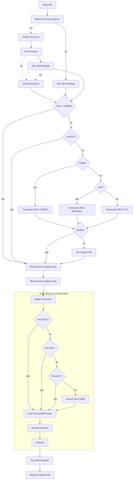

# tdarr

Version-controlled Tdarr configuration.

Server: `tdarr-server:8266` (Tdarr 2.86.01), nodes `Nvidia` and `Intel`.

## Layout

```
flows/      Flow definitions, exported from the Tdarr UI as JSON.
plugins/    Local plugin source (.js), mirrors the server plugin folder.
```

## flows/

Flows are not files on the server — they live in SQLite at
`server/Tdarr/DB2/SQL/database.db`, table `flowsjsondb`, one JSON blob per row.
(The `DB2/FlowsJSONDB/` folder is an empty leftover from an older storage
format.) These files are therefore exported artifacts, not a source of truth.
The round trip is manual:

- **Export**: Flows tab → open the flow → export to JSON → save over the file here.
- **Import**: Flows tab → import → select the file.

Commit after every meaningful change so the repo stays a usable backup. If a
flow is edited in the UI and not re-exported, this repo is stale — re-export
before making changes on disk.

Note the DB row uses a slightly different key set than a UI export: `_id`,
`name`, `priority`, `flowPlugins`, `flowEdges`, `isUiLocked`, with no
`description` or `tags`. Edges carry `animated` and `type` fields that the UI
export strips. `flows/transcode-pipeline.json` is in DB shape and imports fine.

## plugins/

These are real source files. On the server they live under:

- Classic plugins: `/app/server/Tdarr/Plugins/Local/*.js`
- Flow plugins: `/app/server/Tdarr/Plugins/FlowPlugins/LocalFlowPlugins/<name>/<version>/index.js`

Copy them in preserving that structure. `LocalFlowPlugins` is currently empty —
everything in use is either a community flow plugin or a local classic plugin.

---

# Transcode Pipeline

The single flow (`a_CeSjPzb`) applied to the TV library. Its job: get every file
to MKV + HEVC video + exactly one English AC3 audio track + English subtitles,
in that stream order, with accurate track statistics.

## Stages

**1. Container.** `Remux & Heal Container` runs the local `RemuxMKV` plugin,
which no-ops when the file is already MKV. On failure the flow falls through
`Reset Flow Error` → `Force Remux` (`ForceRemuxMKV`), which rebuilds the
container unconditionally — the healing path for files with broken indexes.
Either way it lands on `Run MKVPropEdit`, which writes track statistics tags.

**2. Size gate.** `File <= 100MB?` sends tiny files straight to the audio and
subtitle cleanup, skipping video transcode entirely — not worth the GPU time.

**3. Video.** `Is HEVC?` skips anything already HEVC. Otherwise the flow picks
an encoder by node name: `Nvidia?` routes to NVENC (`Migz1FFMPEG`), `Intel?` to
QuickSync (`Boosh_FFMPEG_QSV_HEVC`), and anything else falls back to a CPU
encode (`Migz1FFMPEG_CPU`) rather than being handed the wrong GPU path.
`Compare File Size Ratio` then guards the result — if the new file isn't
smaller, `Set Original File` discards it and the original is kept.

**4. Language cleanup.** `Remove Non English Audio` and `Remove Non English Subs`
(local `CleanAudio` / `CleanSubs`) strip non-English tracks and commentary. SDH
subtitles are kept.

**5. Audio.** An ffmpeg-command block that plans one command and executes it
once. The policy is **pass-through**: leave audio alone if it already
direct-plays, and only convert what doesn't. `Begin Command` snapshots the
streams, then:

- Three `checkAudioCodec` nodes ask in turn whether the file already has
  `eac3`, `ac3` or `aac`. Any hit skips straight to the drop step — no
  re-encode. This is the whole point of the design: a library sweep found ~90%
  of shows already carry one of those three, so normalising everything to a
  single codec meant re-encoding almost the entire library for no playback
  benefit.
- Only if none of the three is present does `Ensure EAC3 384k` run, cloning the
  highest-channel-count English stream into E-AC3. It requests 6 channels and
  the plugin clamps to `min(wanted, available)`, so 8ch → 5.1, 6ch → 5.1,
  2ch → stereo. In practice this fires on DTS, TrueHD, FLAC, Opus, Vorbis and
  MP3 sources.
- `Drop Incompatible Audio` then removes any audio stream whose `codec_name` is
  not one of `eac3,ac3,aac`. The condition must be **`not_equals`**, not
  `not_includes` — the plugin does substring matching for `includes`, and
  `"eac3".includes("ac3")` is true, which would silently keep the wrong
  streams.
- Files keep whatever bitrate they arrived with. Nothing is normalised
  downwards; the flow preserves rather than re-encodes.
- `Reorder Streams` sorts to video → audio → subtitles, highest channel count
  first within audio.
- `Execute` builds and runs the command. Streams with no output args get
  `-c copy`, so video and subtitles are remuxed, never re-encoded. If nothing
  changed, it skips ffmpeg entirely.

**6. Finalise.** A second `Run MKVPropEdit` re-stamps statistics tags so the new
audio track reports its real bitrate and size, then `Replace Original File`
swaps the cache file over the original. Its `err1` output also goes to Replace —
a tagging failure shouldn't discard a good transcode.

## Graph



## Known wrinkles

- **The three encoder paths use different plugins.** NVENC and CPU use
  `Migz1FFMPEG` / `Migz1FFMPEG_CPU`; QuickSync uses `Boosh_FFMPEG_QSV_HEVC`.
  They have different bitrate logic, so output size varies by which node picks
  up a file. All three are now pinned explicitly.
- **Files with several acceptable audio tracks keep all of them.** `Drop
  Incompatible Audio` filters by codec, not by count, so a file carrying (say)
  eight English aac/eac3 streams keeps all eight — the "one audio stream" goal
  is not enforced. `CleanAudio` catches non-English and commentary tracks
  upstream, which handles the common case but not this one. A library sweep
  found ~2% of shows affected. Fixing it properly needs a small local flow
  plugin; there is no stock "keep only the first audio stream" plugin.
- **Already-processed files are never downgraded in channel count.** Ensure only
  adds a track when none matches; it won't rebuild a stereo track from a
  surround source after the fact.
- **E-AC3 cannot be bitstreamed over optical/S/PDIF**, which carries only AC3
  and DTS. Over HDMI/eARC this is a non-issue. If a client can't handle E-AC3 it
  transcodes server-side — a performance cost, not a broken file.
- **AV1 sources are transcoded to HEVC**, which is backwards efficiency-wise.
  One show in the library is affected.
