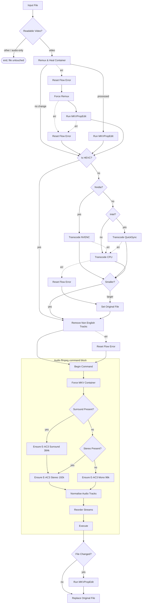

# Transcode Pipeline

A single Tdarr flow (`a_CeSjPzb`, `flows/transcode-pipeline.json`), applied to
both the TV and Film libraries.

## Goal

Bring every file in the library to:

- **MKV** container
- **HEVC** video
- **English audio only**, in a directly playable codec — at most one surround
  track and one stereo/mono track, surround first
- **English subtitles only**, no commentary
- accurate track statistics tags

Files that already match are left byte-identical, with mtime intact.

## Stages

### 1. Gate

`Readable Video?` (`fileMedium`) admits video files only. Audio-only files and
files with no readable media (e.g. a truncated download missing its `moov`
atom) exit immediately with the library file untouched.

### 2. Container

`Remux & Heal Container` runs the local `RemuxMKV` plugin, which no-ops on a
file that is already MKV and otherwise stream-copies into Matroska with
`-fflags +genpts`.

On failure the flow takes `Reset Flow Error` → `Force Remux` (`ForceRemuxMKV`),
which accepts any input container and adds `+igndts`, enlarged
`analyzeduration`/`probesize`, `-err_detect ignore_err` and
`-avoid_negative_ts make_zero`. Both attempts are pure stream copies; nothing is
re-encoded. If `Force Remux` also fails, the file continues in its original
container.

Each remux branch is followed by `Run MKVPropEdit`, behind an `Is MKV?`
(`checkFileExtension`) guard.

### 3. Video

`Is HEVC?` passes HEVC files straight through. Otherwise the encoder is chosen
by node name:

| condition | plugin |
|---|---|
| `Nvidia?` | `Migz1FFMPEG` (NVENC) |
| `Intel?` | `Boosh_FFMPEG_QSV_HEVC` (QuickSync) |
| otherwise | `Migz1FFMPEG_CPU` |

NVENC and QuickSync fall back to the CPU encoder on error; a CPU failure routes
through `Reset Flow Error` to `Set Original File`, keeping the source.

`Compare File Size Ratio` guards the output: if the new file is not smaller,
`Set Original File` discards it.

### 4. Language cleanup

`Remove Non English Tracks` (local `CleanTracks`) removes non-English audio and
subtitles, commentary tracks, and optionally SDH subtitles — all in a single
pass over the file.

- Commentary is detected from the `comment` disposition flag or `comment` in the
  stream title.
- SDH is detected from the `hearing_impaired` disposition flag or `sdh` in the
  title. The two tests are independent, gated by `remove_commentary` and
  `remove_sdh` respectively.
- Streams with no language tag are kept.
- The last audio stream is never removed.

### 5. Audio

An ffmpeg-command block that plans one command and executes it once. Result:

| source audio | result |
|---|---|
| surround (4–8ch), with or without stereo | E-AC3 surround + E-AC3 2.0 @192k |
| 7.1 | downmixed to 5.1, plus E-AC3 2.0 @192k |
| stereo only | single E-AC3 2.0 @192k |
| mono only | single E-AC3 1.0 @96k |
| no English track | left untouched |

The layout is decided by channel count alone, not by existing codec.

Nodes, in order:

- `Begin Command` snapshots the streams.
- `Force MKV Container` pins the output container (`Begin Command` otherwise
  seeds it from whatever the working file currently is).
- `Surround Present?` — `checkStreamProperty` on `channels`, matching
  `4,5,6,7,8`.
- `Ensure E-AC3 Surround 384k` requests 6 channels; the plugin clamps to
  `min(wanted, available)`, so 8ch → 5.1, 6ch → 5.1, 4ch → 4ch.
- `Ensure E-AC3 Stereo 192k` always runs on the surround branch and on the
  `Stereo Present?` branch. It matches on codec **and** exact channel count, so
  it is a no-op on a stereo-only source that is already E-AC3.
- `Ensure E-AC3 Mono 96k` handles mono-only files. Mono is never upmixed.
- `Normalise Audio Tracks` (local plugin) reduces to one surround and one
  stereo/mono track, preferring E-AC3, then channel count, then bitrate, and
  sets the audio order with surround first.
- `Reorder Streams` is configured for `streamTypes` only.
- `Execute` builds and runs the command. Streams with no output args get
  `-c copy`, so video and subtitles are remuxed, never re-encoded.

`Ensure Audio Stream` matches the configured language and falls back to `und`
for untagged streams, never to "any language" — so a file with no English audio
has nothing generated and keeps its original track unconverted.

The block is idempotent: on a file that already matches the policy both Ensure
nodes report "File already has…" and nothing is re-encoded.

`Execute` has no error edge; an ffmpeg failure fails the job.

### 6. Finalise

`File Changed?` (`checkFileChanged`) compares the working file against the
original library file by path **and** size.

- Changed → `Run MKVPropEdit` re-stamps statistics tags → `Replace Original
  File`.
- Unchanged → straight to `Replace Original File`, which is itself a no-op.

The final `Run MKVPropEdit` has no `err1` edge, so a failed run never commits to
the library: the working copy stays in cache and the job reports the error.

## Graph



## Local plugins

Classic plugins live at `/app/server/Tdarr/Plugins/Local/*.js`; flow plugins at
`/app/server/Tdarr/Plugins/FlowPlugins/LocalFlowPlugins/<category>/<name>/<version>/index.js`.
`plugins/` mirrors that structure.

Used by the flow:

- `RemuxMKV` — stream-copy remux to MKV, no-op if already MKV.
- `ForceRemuxMKV` — permissive remux, any input container.
- `CleanTracks` — single-pass removal of non-English / commentary / SDH tracks.
- `normaliseAudioTracks` — reduce to one surround + one stereo/mono track and
  set audio order.

Not referenced by the flow, kept in the repo: `CleanAudio`, `CleanSubs`,
`keepOneAudioStream`.

## Deploying a change

Flow edits take effect on import. Local plugin changes do not — nodes run
plugins from their own synced copy at `/app/Tdarr_Node/assets/app/plugins/...`.

1. Copy the plugin file to the server, preserving the directory layout.
2. Restart the Tdarr **node** (not just the server).
3. Flows tab → import → `flows/transcode-pipeline.json`.

Flows are stored in SQLite at `server/Tdarr/DB2/SQL/database.db`, table
`flowsjsondb`, one JSON blob per row; `flows/*.json` are exported artifacts.
Export via Flows tab → open flow → export to JSON.

Verify before a bulk run:

```sh
pnpm test        # assertions against the real flow and real plugin source
pnpm lint:flow   # structural lint
pnpm fuzz        # synthetic files through the flow
```

Server: `tdarr-server:8266` (Tdarr 2.86.01), nodes `Nvidia` and `Intel`.
